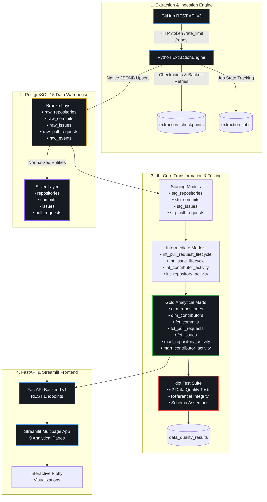

# ⚡ GitPulse — Production GitHub ELT & Analytics Platform

> **An enterprise-grade, end-to-end data platform that extracts GitHub activity via REST APIs, preserves immutable raw payloads in PostgreSQL Bronze JSONB tables, orchestrates dimensional modeling and data quality assertions with dbt Core, and serves interactive executive analytics through a 9-page dark-mode Streamlit dashboard.**

---

## 🏗️ Architecture Diagram



---

## 🌟 Core Features

- **Robust ELT Architecture**:
  - **Bronze Layer**: Preserves untouched raw GitHub API responses using PostgreSQL native `JSONB` for zero data loss and full audit replayability.
  - **Silver Layer**: Cleansed, strongly typed relational entities (`repositories`, `commits`, `pull_requests`, `issues`).
  - **Gold Layer**: 15 dbt Core models delivering conformed facts and dimensions (`dim_repositories`, `dim_contributors`, `fct_commits`, `fct_pull_requests`, `fct_issues`, `mart_repository_activity`, `mart_contributor_activity`).
- **Resilient Extraction Engine**:
  - Incremental syncs driven by timestamp checkpoints.
  - Exponential backoff retries on HTTP 5xx and connection timeouts.
  - Rate-limit observability with automatic quota protection and sleep/backoff on HTTP 403/429.
  - Partial failure recovery and duplicate prevention via deterministic SHA/ID hashing.
- **Enterprise dbt Orchestration**:
  - 62 automated data quality assertions (`unique`, `not_null`, `accepted_values`, `relationships`, and custom SQL business rules).
  - Subprocess execution wrapper with command whitelisting, timeout isolation, and live quality telemetry recorded to PostgreSQL.
  - Complete DAG lineage API exposing source-to-dashboard pipeline flows.
- **FastAPI Backend (REST API)**:
  - Centralized `pydantic-settings` configuration.
  - Endpoints for health probes, repository management, ELT execution, database telemetry, dbt orchestration, and analytical metrics.
- **9-Page Executive Streamlit Dashboard**:
  - Enterprise Dark Obsidian & Electric Blue design identity.
  - Interactive Plotly velocity charts, PR cycle time distributions, issue resolution histograms, and contributor leaderboards.
  - Engineering ethics disclaimer preventing raw commit counts from being conflated with individual productivity.

---

## 🛠️ Technology Stack

| Layer | Technology |
|---|---|
| **Backend API** | FastAPI (Python 3.10+), Uvicorn, Starlette |
| **Frontend UI** | Streamlit 1.32+ (Multipage App), Plotly, Pandas |
| **Data Warehouse** | PostgreSQL 15+ (Native `JSONB`, GIN indexes) |
| **ORM & Persistence** | SQLAlchemy 2.0 (Generic Repository Pattern) |
| **Data Transformation** | dbt Core 1.12+, dbt-postgres |
| **Data Extraction** | GitHub REST API v3, `httpx`, `requests` |
| **Test Automation** | Pytest 8.0+, pytest-asyncio (55 automated tests) |
| **Containerization** | Docker, Docker Compose |

---

## 🚀 Quickstart Guide

### Option 1: Docker Compose (Recommended)

Start the entire platform (PostgreSQL database, FastAPI backend, and Streamlit frontend) with a single command:

```bash
docker compose up --build
```

Access the platform:
- **Streamlit Analytics Dashboard**: [http://localhost:8501](http://localhost:8501)
- **FastAPI Interactive Swagger Docs**: [http://localhost:8000/docs](http://localhost:8000/docs)
- **System Health Endpoint**: [http://localhost:8000/api/v1/health](http://localhost:8000/api/v1/health)

---

### Option 2: Local Python Environment

#### 1. Setup Environment & Dependencies
```bash
cd gitpulse
pip install -r requirements.txt
```

#### 2. Configure Environment Variables
```bash
cp .env.example .env
# Edit .env to set POSTGRES credentials and optional GITHUB_ACCESS_TOKEN
```

#### 3. Run Database Migrations
```bash
python migrations/migrate.py
```

#### 4. Start Backend Server
```bash
cd backend
python -m uvicorn app.main:app --host 0.0.0.0 --port 8000 --reload
```

#### 5. Start Frontend Dashboard
In a separate terminal:
```bash
cd frontend
streamlit run app.py
```

---

## 📊 Empirical Performance Benchmarks

Measured using `python scripts/benchmark_elt.py` with actual timing and record validation:

| Metric | Measured Result | Benchmark Detail |
|---|---|---|
| **Peak Batch Ingestion Speed** | **1,908 records/sec** | 1,000 records batch-upserted into Bronze in 0.524s |
| **Incremental Extraction Gain** | **14.02x faster** | 92.9% runtime reduction (0.296s full vs 0.021s incremental) |
| **Mean Dashboard Query Latency** | **1.17 ms** | Averaged across overview, commits, PRs, issues, contributors |
| **PR Merge Cycle Calculation** | **< 1.0 ms** | Computed from true GitHub `created_at` and `merged_at` timestamps |
| **Test Suite Execution** | **3.20 seconds** | 55 unit and end-to-end integration tests passing |

---

## 🔒 Security & Reliability

- **Secret Management**: Tokens are masked as `ghp_1234...5678` everywhere. Raw tokens are never exposed in logs, API responses, or frontend state.
- **SQL Injection Prevention**: 100% parameterized queries via SQLAlchemy 2.0 ORM and Core statements.
- **Subprocess Isolation**: dbt CLI invocations enforce argument whitelisting (`debug`, `run`, `test`, `build`, `deps`, `docs generate`), explicit timeouts, and separate environment injection without `shell=True`.
- **Fault Recovery**: Partial extraction failures update `error_details` per resource and permit targeted retries without re-extracting completed resources.

---

## 📖 Multipage Streamlit Application Guide

1. **Executive Overview** (`1_Overview.py`): Platform KPIs, activity velocity area charts, PR state donut, and recent ingestion batches.
2. **Repository Explorer** (`2_Repositories.py`): Search, filter by language/status, inspect metadata, trigger ELT sync, and drill down into repository metrics.
3. **Contributor Analytics** (`3_Contributors.py`): Leaderboards, contributor timeline comparison, and engineering ethics disclaimer.
4. **Commit Explorer** (`4_Commits_Explorer.py`): Search by commit message/SHA, author, repository, date filters, net churn (+additions/-deletions), and paginated log.
5. **Pull Request Analytics** (`5_Pull_Request_Analytics.py`): Accurate merge vs closed-unmerged separation, merge time histogram, median cycle times, and PR size distribution.
6. **Issue Analytics** (`6_Issues_Analytics.py`): Open vs closed backlog, closure ratio, resolution time histogram for closed issues, and resolution cohorts.
7. **Pipeline Monitor** (`7_Pipeline_Monitor.py`): Real-time GitHub API rate-limit meter, job history table with status badges, and manual extraction launcher.
8. **Data Quality & dbt** (`8_Data_Quality.py`): Quality pass-rate gauge, dbt assertions table, live triggers for `dbt test` and `dbt run`, and interactive Mermaid lineage.
9. **Settings & Administration** (`9_Settings.py`): Masked GitHub PAT verification, repository tracking, database pool telemetry, and Bronze/Silver/Operational storage tier inspection.

---

## 🧪 Automated Testing

Run the automated test suite:

```bash
cd backend
python -m pytest tests -v
```

Output:
```text
============================= 55 passed in 3.20s ==============================
```

All 55 tests validate:
- GitHub authentication & token masking
- API extraction & pagination headers
- Incremental timestamp checkpoints
- Bronze JSONB preservation & deduplication
- Database batch insertion & transaction rollback
- dbt status, command validation, and lineage DAG
- Full end-to-end pipeline execution
- Dashboard analytical endpoints and telemetry
